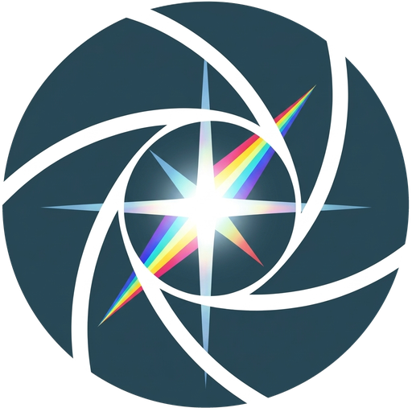

  

<h1 align="center">LumièreHDR</h1>

  
  
  

LumièreHDR turns a series of differently exposed photos into one HDR image
and tone maps it into a picture that shows detail in both the shadows and
the highlights. It is a modernized fork of
[Luminance HDR](https://github.com/LuminanceHDR/LuminanceHDR) 2.6, focused on
security, a clearer user interface and current platforms, and it stays free
software under the GNU GPL v2.

## Download

Windows installer and portable zip: see
[Releases](https://github.com/thommy87/LumiereHDR/releases).
The installer needs no administrator rights.

## Workflow

1. **Import / Merge**: create an HDR image from bracketed exposures (JPEG,
   TIFF or raw), or open an existing HDR file.
2. **Tone map**: pick a preset from the strip under the image, or choose one
   of 15 tone mapping operators and adjust its settings.
3. **Export**: save the result, or tone map many images at once with Batch
   tone mapping.

## Features

- 15 tone mapping operators with plain-language names and a short
  explanation each (Mantiuk, Fattal, Reinhard, Drago, Durand and more)
- Presets: seven built-in looks plus your own, with a preview of each under
  the image
- Before/after comparison of the result with the original photos
- Live histogram with clipped highlights and shadows, and image facts such
  as the dynamic range in stops
- Undo/redo and a history list for rotate, resize and projective
  transformation
- Batch HDR creation that hands its results straight to Batch tone mapping
- Light and dark colour schemes that follow Windows; German and other
  translations

### File formats

| | Formats |
|---|---|
| HDR, open and save | OpenEXR (`.exr`), Radiance RGBE (`.hdr`), TIFF 16/32-bit and LogLuv, PFS |
| HDR, open | Camera raw files via [LibRaw](https://www.libraw.org/), FITS |
| Results, save | JPEG, PNG, TIFF, **AVIF**, **JPEG XL**, **WebP**, BMP, PPM, PBM |

## What changed from Luminance HDR 2.6

- Security fixes: a heap overflow in the Radiance `.hdr` reader, an update
  check over plain HTTP (now HTTPS and opt-in), and exploit mitigations
  (ASLR, DEP, CFG) in the Windows build
- Built with Qt 6 and C++20, with continuous integration, sanitizers, a
  fuzzer for the Radiance reader and golden-image tests for every operator
- New interface pieces: step bar, preset strip, comparison, histogram,
  history and plain operator names
- Fixed Ferwerda96 rendering black, Mai11 settings that could not be saved,
  and more; see the [Changelog](Changelog)

## Building

See [INSTALL.md](INSTALL.md) for dependencies and build steps.

## Policies

- [Code signing policy](CODE_SIGNING_POLICY.md): free code signing provided
  by [SignPath.io](https://about.signpath.io), certificate by
  [SignPath Foundation](https://signpath.org)
- [Privacy policy](PRIVACY.md)
- Bugs and feature requests:
  [Issues](https://github.com/thommy87/LumiereHDR/issues)

## Credits

LumièreHDR builds on Luminance HDR:

- Copyright (C) 2010-2019 Davide Anastasia, Franco Comida, Daniel Kaneider,
  and many contributors and translators
- Copyright (C) 2006-2010 Giuseppe Rota
- Luminance HDR on [GitHub](https://github.com/LuminanceHDR/LuminanceHDR) and
  [SourceForge](https://sourceforge.net/projects/qtpfsgui)

Parts of the code are based on "pfstools", "pfstmo" and "pfscalibration" by
Grzegorz Krawczyk and Rafał Mantiuk, and on "qpfstmo" by Nicholas Phillips.

## License

GNU General Public License, version 2 or (at your option) any later version.
See [LICENSE](LICENSE).
